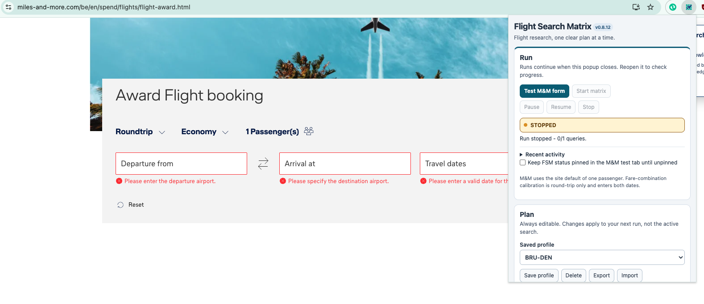

# Flight Search Matrix

Flight Search Matrix is a Manifest V3 Chrome extension for repeatable flight award and cash-fare research. It is designed around unreliable airline/loyalty search engines: every attempt is preserved, a single negative response is not treated as conclusive, and confirmed positive availability outranks later failures.

> **Project status:** the research engine and local workflows are usable, while
> provider-specific adapters remain experimental calibration work. FSM is not a
> booking service: it does not bypass login, MFA, CAPTCHA, Cloudflare, rate
> limits, or other provider controls.

Current version: **0.8.12**



_FSM uses a compact floating popup so its plan and run state remain available
without replacing the provider page. Provider controls and account verification
remain under the user's control._

FSM uses an airplane-and-matrix icon in Chrome. The master artwork is [fsm-airplane-matrix-source.png](icons/fsm-airplane-matrix-source.png); Chrome consumes the generated 16, 32, 48 and 128 px PNG files under `icons/`.

For departure and arrival lists, enter one airport/group per line, or separate entries with commas or semicolons. For example, `BRU`, `AMS`, and `CDG` may be entered as three lines or as `BRU, AMS; CDG`. FSM accepts a pasted literal `\n` as a newline too. This is simple delimiter-separated input, not a full CSV import format.

Click the FSM toolbar icon to open the floating popup. It dismisses when you click outside; active searches remain owned by the background worker. Reopening restores run status and your locally saved Plan draft. For an M&M test, **Keep FSM status pinned in the M&M test tab until unpinned** displays a small in-page card across M&M navigation, including the manual fare and cart path after the automated form step. The extension no longer registers a Chrome side panel.

The floating popup uses a compact Run area followed by an always-editable Plan. Monitoring options, results/history and Support/diagnostics expand on demand. Its 420 px document canvas and content column are deliberately the same width, avoiding empty popup background beside the controls. Diagnostics and Google Sheets sync are under Support. Existing profiles, controls and search behavior are retained.

M&M guided tests retain digit-by-digit typing and wait up to 6 seconds for the separate outbound/return fields to match the requested dates, carry M&M's validated ISO date attributes, and remain valid. Search is blocked if this commit check fails; visible range text alone is not accepted.

## What the extension can do

- Build matrices from multiple origins, destinations, date ranges, cabins and passenger counts.
- Generate one-way, round-trip and true open-jaw searches.
- Expand airport groups such as NYC, WAS, LON, PAR, YELLOWSTONE_NORTH and YELLOWSTONE_SOUTH.
- Estimate total queries and maximum retry attempts before running.
- Prioritize preferred airport/cabin order and central dates first.
- Reprioritize adjacent dates after availability is found.
- Apply per-provider pacing, jitter and exponential backoff.
- Persist interrupted run position for Chrome service-worker recovery.
- Save search profiles.
- Apply constraints for maximum stops, connection airports, carriers and mixed cabin.
- Record every raw observation in IndexedDB.
- Consolidate retries into query summaries without erasing positive evidence.
- Retain best-known results across runs.
- Normalize itinerary/segment fields when an adapter exposes them.
- Record parser version, confidence and price-scope semantics.
- Export CSV.
- Sync to Google Sheets tabs: Runs, Queries, Observations and Current Best.
- Capture a visible page manually for providers without an automated adapter.

## Miles & More status

Miles & More remains the first experimental automated adapter. The generic engine is significantly ahead of the site-specific parser.

- Ordinary search automation remains experimental.
- M&M has a calibrated native-click flow: it verifies each form action, leaves the default passenger count at one, and activates Search flights once through Chrome native input.
- M&M remains a one-query, round-trip-only calibration flow while the adapter learns to combine outbound and return fare choices. It refuses one-way input so both dates remain part of every cart-path test.
- A single M&M no-result page does not become a final negative.
- Technical errors and timeouts remain INCONCLUSIVE.
- Login/MFA/human verification become NEEDS_USER.
- Open-jaw M&M automation deliberately pauses pending a real logged-in calibration pass.

No CAPTCHA, MFA, Cloudflare or other verification bypass is attempted.

## Install for development

1. Extract the release ZIP.
2. Open `chrome://extensions`.
3. Enable Developer mode.
4. Choose Load unpacked and select the extracted project folder.
5. Click the extension action to open its side panel.

## Development

Requires a recent Node.js for tests only. The extension itself has no npm runtime dependencies.

```sh
npm test
npm run check
npm run verify
npm run release:check
npm run release:package
```

`npm run verify` runs unit tests, JavaScript syntax checks, version consistency checks and the repository-wide no-em-dash rule.

See [public project status](docs/PUBLIC_STATUS.md),
[security reporting](SECURITY.md), and [contribution guidance](CONTRIBUTING.md).

`npm run release:check` also requires a fresh, real Miles & More guided-browser proof. Complete one guided M&M test through result navigation, use **Download release-test proof**, and save the downloaded JSON as `tests/live/miles-and-more-browser-gate.json`. The proof expires after 72 hours and must match the release version. `npm run release:package` runs this gate before creating the ZIP and checksum.

## Data model

The core schema is provider-neutral:

- Run
- Search definition
- Query
- Leg
- Observation
- Itinerary
- Segment
- Query summary
- Current Best

This is intentional: Miles & More, Lufthansa, United or another future adapter should translate into the same internal model rather than leaking site-specific fields throughout the extension.

## Google Sheets

See `google-apps-script/SETUP.md`. The Apps Script creates:

- `Runs`: run-level configuration snapshots and completion status.
- `Queries`: consolidated retry evidence for individual searches.
- `Observations`: every individual provider attempt.
- `Current Best`: the best retained result for each normalized query key.

IndexedDB is always the primary write. Sheets synchronization happens afterward so failed network sync does not lose search history.

## Built-in airport groups

Current built-ins include:

- NYC: JFK, EWR, LGA
- WAS: IAD, DCA, BWI
- LON: LHR, LGW, LCY, STN, LTN
- PAR: CDG, ORY
- TYO: HND, NRT
- CHI: ORD, MDW
- YELLOWSTONE_NORTH: BZN, BIL
- YELLOWSTONE_SOUTH: JAC, IDA, SLC

The core API also accepts custom airport-group maps; an editor for those maps remains a 0.5.x UI backlog item.

## Release policy

Semantic Versioning is documented in `docs/VERSIONING.md`. Immutable ZIPs and SHA-256 checksums belong under `releases/` in the Drive project.

## Current blockers after 0.6.1

The remaining major items are not generic coding blockers:

1. Live M&M calibration against the logged-in current site.
2. Choosing and calibrating the first second-provider automated adapter.
3. Deciding whether Chrome notification permission and alert UX are wanted.
4. Provider-specific confirmation of per-traveler versus party-total mileage and fees.

See `docs/STATUS.md` and `docs/BACKLOG.md` for the exact handoff state.

## 0.6.0 cash-provider behavior

The extension now includes experimental Lufthansa and Brussels Airlines cash adapters. They share Lufthansa Group form/result heuristics but remain deliberately conservative until calibrated against live booking-result markup. If the expected controls cannot be identified, the query becomes NEEDS_USER or INCONCLUSIVE rather than producing a fabricated result.

Cash comparison uses one rule: **per-person total including fees**. A public route-page or booking-page "from" fare may be retained as a useful observation, but it is marked non-comparable and is not eligible to become Current Best until the adapter can identify a total price including fees.

Chrome notifications are optional and disabled by default. Profile JSON import/export, last-run cloning, custom airport groups, Current Best filters/history, and diagnostic snapshot download are available from the side panel.

## Current M&M behavior

Miles & More begins on the Award Flight booking form. The adapter sets and verifies travel type, cabin, origin, destination, and validated dates, leaves M&M's default passenger count at one, then activates Search flights once with Chrome native input. Result-page navigation is recorded as a live browser test.

M&M result parsing recognizes explicit negative result states before considering generic mileage text, so the account mileage balance is not treated as award availability.

## 0.6.9 M&M startup repair

When a guided M&M test opens its dedicated tab, the extension now waits for both the booking controls and the page adapter before attempting any form action. It retries the connection while the page hydrates and refreshes the adapter once if needed. If the form still cannot start, the side panel reports the missing controls or connection detail rather than appearing idle.

## 0.6.10 M&M failure reporting

When M&M does not verify a requested form field, the activity timeline and final state now retain the exact field name. The generic “without a confirmed submitted search” message is no longer used for a form-calibration failure.

## 0.6.11 M&M default passenger handling

One passenger is already the M&M form default, so the current calibrated flow leaves the passenger picker untouched regardless of the saved matrix adults value.

## 0.6.12 single M&M submission

After verifying the requested form entries, the guided M&M test activates Search flights exactly once and waits for result navigation. It has no fallback submit action and does not retry the button. If navigation is not observed, it reports that one activation occurred without a result-page transition.

## 0.6.3 M&M date entry

For Miles & More round trips, the adapter first types the compact date pair directly into the Travel dates input, for example 1705202727052027. The site is expected to expand this to formatted dates. The adapter verifies the result and falls back to calendar interaction only if direct entry fails.

## 0.6.4 live-test fixes

The side panel shows the running version in its header and keeps a persistent color-coded state, activity timeline and Download diagnostic in Run controls. Miles & More one-way tests actively select and verify One way before entering the single compact date. Automatic Search flights submission remains deliberately disabled.
